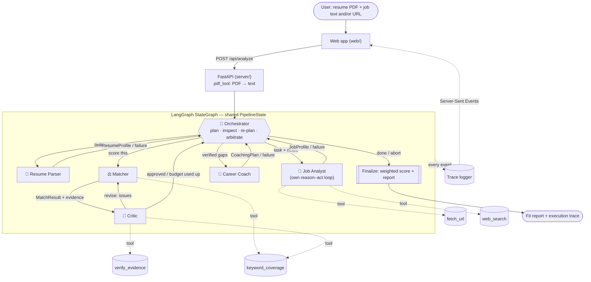

# HireLens — Design Document

## 1. Architecture



Solid arrows are messages between agents (direction = data flow). Dotted arrows are tool calls. Every agent writes its output to the shared `PipelineState`, and every plan, decision, tool call, critique and hand-off is appended to the trace as it happens.

Text version of the same flow:

1. **Orchestrator** receives the input summary and makes an LLM plan (agent order plus notes for specific agents).
2. **Resume Parser** → back to Orchestrator, which checks extraction quality and may re-run it with a hint, continue with a warning, or abort.
3. **Job Analyst** loops over `fetch_url` / `web_search` / `finish` until requirements are clear → back to Orchestrator, which may send it back to search again.
4. **Matcher** → **Critic** → (revise → **Matcher** → **Critic**, at most 2 revisions) → **Orchestrator** (arbitrates if still unresolved).
5. **Career Coach** → **Orchestrator** → **Finalize**.

## 2. Agents

| Agent | Responsibility | Inputs | Output | Tools | Adaptive behaviour |
|---|---|---|---|---|---|
| **Orchestrator** (`agents/orchestrator.py`) | Plans the run, routes work, inspects every result, re-plans, resolves conflicts | Input summary; each worker's result or failure | Plan, next agent, notes to agents, arbitration | — | LLM plan at start; LLM decision when the parser output is weak, the job is vague, or Matcher and Critic still disagree; retry/skip/abort policy on failures |
| **Resume Parser** (`agents/resume_parser.py`) | Resume text → structured profile; judges its own confidence | Resume text, optional Orchestrator hint | `ResumeProfile` (skills, experience, projects, education, `parse_confidence`, `is_resume`) | — | Reports low confidence / non-resume so the Orchestrator can re-plan; uses the hint on retry |
| **Job Analyst** (`agents/job_analyst.py`) | Works out the role's must-have and nice-to-have requirements | Pasted JD, URL, Orchestrator note | `JobProfile` with `completeness`, `sources`, `enrichment_used` | `fetch_url`, `web_search` | Reason–act loop: decides each step whether to fetch, search the careers page, or finish; recovers when a fetch fails |
| **Matcher** (`agents/matcher.py`) | Scores the five sections with verbatim resume quotes as evidence | Both profiles, resume text, keyword coverage, Critic issues on revision | `MatchResult` | `keyword_coverage` | On revision, must lower each disputed score or supply real evidence, and explain each decision |
| **Critic** (`agents/critic.py`) | Verifies the Matcher's claims; sends inflated scores back | Profiles, `MatchResult`, resume text | `Critique` (approve/revise + issues + suggested scores) | `verify_evidence`, `keyword_coverage` | Tool checks + LLM judgement; policy layer forces "revise" if >30% of quotes are not in the resume, a high score has no evidence, or a claimed must-have is absent |
| **Career Coach** (`agents/career_coach.py`) | Turns verified gaps into bullets, interview questions, gap actions | Verified `MatchResult`, profiles, existing bullets | `CoachingPlan` | — | Targets only the gaps the Critic verified; may not invent achievements |

## 3. Orchestration pattern

**Orchestrator–worker with plan-and-replan, plus a peer critique loop (Matcher ⇄ Critic) over a shared state (blackboard).**

Why this pattern:
- **Orchestrator–worker** keeps one agent responsible for the overall goal, so failures and surprises have one place where they are handled. Every worker reports back to it, which is what makes re-planning possible.
- **Plan-and-replan instead of an LLM call at every step.** The Orchestrator uses the LLM to plan and whenever a result is unexpected, but follows its plan without an extra call when results are fine. This keeps a run within free-tier rate limits while still letting the LLM make every non-routine decision.
- **Direct Matcher ⇄ Critic loop.** Critique and revision is a conversation between two peers; routing it through the Orchestrator would add calls without adding judgement. The Orchestrator steps in only if they cannot agree within the revision budget, and then arbitrates.
- **Shared typed state.** All agents read and write one `PipelineState`; every message is validated against a Pydantic schema (`lib/schemas.py`) before the next agent sees it.

Why not a fixed pipeline: the order and number of steps change per input. A vague posting adds search and fetch steps; an inflated score adds Matcher–Critic rounds; a weak extraction adds a parser retry; a non-resume stops the run. Those branches are chosen by agent reasoning (recorded in the trace), not by a hard-coded flow.

## 4. Coordination and conflict resolution

| Situation | Who decides | What happens | Trace evidence |
|---|---|---|---|
| Matcher claims something the resume does not show | Critic (tools + LLM) | `revise` with issues → Matcher revises | `critique`, `handoff critic → matcher`, `revision` |
| Critic LLM approves but quotes fail verification | Critic policy | Approval overridden to `revise` | `decision: Policy override …` |
| Still disagreeing after 2 revisions | Orchestrator (LLM) | `apply_critic_scores` or `keep_matcher_scores` | `plan: Re-plan … → apply_critic_scores`, `decision: Applied critic's adjustments` |
| Job posting vague or only a URL | Job Analyst (LLM) | Searches careers page, fetches results | `tool_call web_search`, `tool_call fetch_url` |
| Job still unclear after analysis | Orchestrator (LLM) | Re-runs analyst with a search instruction, continues with a warning, or aborts | `plan: Re-plan: The job analyst could not establish …` |
| Weak resume extraction | Orchestrator (LLM) | Re-runs parser with a hint, continues, or aborts | `plan: Re-plan: The resume parser's output looks weak …` |
| An agent fails (rate limit, bad JSON) | Orchestrator (policy) | Core agents retried once then a clean abort; Critic/Coach skipped with a warning | `error`, `plan: Re-plan: … failed` |

## 5. Scoring

Section scores (0–100) come from the Matcher and are verified by the Critic. The overall score is computed in code (`lib/scoring.py`) so it is transparent:

`overall = 0.35·skills + 0.20·experience + 0.20·projects + 0.10·education + 0.15·keywords`

If more than half of the must-have requirements are missing, the overall score is capped at 55. Labels: ≥75 Strong, 55–74 Moderate, 35–54 Weak, <35 Poor fit.

## 6. Technology choices

| Choice | Why |
|---|---|
| **LangGraph** | Conditional edges and cycles express the re-planning and the Matcher ⇄ Critic loop directly; state is explicit and typed. CrewAI/AutoGen hide routing inside the framework, which would make the coordination harder to show and defend. |
| **Python 3.12** | Team familiarity; best library support for PDF, web and LLM tooling. |
| **Gemini Flash via its OpenAI-compatible API** (Groq as alternative) | Free tier, fast, strong at structured JSON. The OpenAI-compatible interface means switching provider is a config change, not a code change. |
| **Per-agent temperature** | Orchestrator, Parser, Matcher, Critic run at 0–0.1 for repeatable judgements; Career Coach at 0.6 for less generic writing. Any agent can be given a different model (`HIRELENS_MODEL_<AGENT>`), e.g. a stronger model for the Critic. |
| **Pydantic** | Every agent-to-agent message is schema-validated; malformed LLM output is caught at the boundary and retried. |
| **Deterministic tools for verification** | The Critic's checks (`verify_evidence`, `keyword_coverage`) are plain code, so an LLM cannot talk its way past them. |
| **pypdf, requests + BeautifulSoup, DuckDuckGo search (`ddgs`)** | Free, no extra API keys needed for PDF reading, page fetching and web search. |
| **FastAPI backend + plain HTML/CSS/JS frontend, deployed on Vercel** | Each analysis runs inside one request whose response streams every trace event to the browser over Server-Sent Events, so users watch the agents work live. Because a run never depends on a second request reaching the same server, it fits Vercel's serverless functions (up to 300 s per run on the free plan). A no-build frontend keeps it to one deployment and one URL; a Dockerfile is kept for other hosts. |
| **pytest + GitHub Actions** | Tests run the whole multi-agent graph and the HTTP API with a scripted model, so routing, the critic loop, failure handling and the live event stream are tested without API calls. |

## 7. Robustness

- **Bad input:** non-PDF, empty, corrupted, encrypted, scanned/image-only PDFs, files over 5 MB, missing job input, invalid or private URLs — each gives a clear message (HTTP 400/413), never a crash.
- **Load:** one running analysis per visitor and a global cap (HTTP 429 with a clear message), so a demo cannot exhaust the free-tier API key.
- **Tool failures:** a failed fetch or search is fed back to the Job Analyst as an observation, and it chooses another approach.
- **LLM failures:** per-minute rate limits are retried with backoff. A used-up daily quota is not retried: the client switches to the next backup key (then any fallback model) within the same call and remembers the used-up key for later runs; when every key is used up, the run stops at once with a clear message instead of running into the hosting time limit; invalid JSON is sent back to the model for repair; schema-invalid output is retried once with the validation error.
- **Partial failure:** if the Critic fails, scores are shown marked unverified; if the Coach fails, the scores are still returned.
- **Loops are bounded:** at most 2 revisions, at most 4 analyst tool steps, at most 2 attempts per agent, and a LangGraph recursion limit, so a run finishes well inside the hosting time limit. If the connection still closes early, the browser says so instead of waiting forever.

## 8. Repository map

```
index.py, vercel.json   Vercel entrypoint and function settings
server/                 FastAPI app: uploads, streaming analysis (SSE), background runs, downloads
web/                    frontend: intake, live agent map, report
agents/                 orchestrator, resume_parser, job_analyst, matcher, critic, career_coach, graph wiring
tools/                  pdf_tool, web_tool (fetch_url, web_search), text_tools (verify_evidence, keyword_coverage)
lib/                    config, LLM client, schemas, scoring, trace logger
tests/                  pytest suite (tools, schemas, full pipeline behaviour, HTTP API and event stream)
scripts/                run_cli.py (captures report + trace), make_sample_resume.py
docs/                   synopsis, design, I/O definitions, JSON schemas, team plan
samples/                sample inputs and the submitted real run
```
